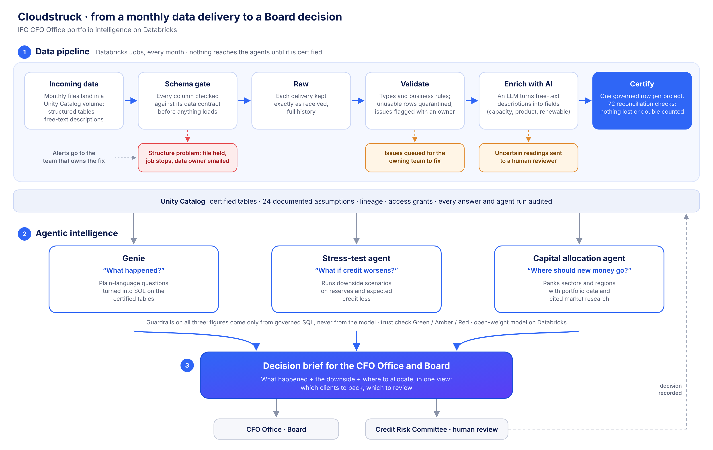

# Cloudstruck: portfolio intelligence for IFC's CFO Office

**Team Cloudstruck:** Akash Mukhopadhyay, Pruthvi Doshi, Sneha Chandrasekaran, Ritvik Kohli · Accenture / BTA "Forward Deployed: Agentic Innovation Challenge", 2026

This README is the **handover document**: what the solution does, where every deliverable is, and how a client team
deploys, operates and maintains it without further support.

## Start here

### Open the app (about 3 minutes)

1. Sign in to the Databricks workspace: **https://dbc-ba139e62-9140.cloud.databricks.com**
2. Left sidebar → **Compute** → **Apps** tab → **ifc-cfo-intelligence**.
3. Click the app URL (https://ifc-cfo-intelligence-7474644524515535.aws.databricksapps.com). It opens with your
   workspace sign-in, so no separate login is needed.

**If the app is switched off.** Databricks stops idle apps and warehouses to save cost, so the app may need switching
on first:

1. **Start the app.** On the app's page (Compute → Apps → **ifc-cfo-intelligence**), if the status reads **Stopped**
   or **Unavailable**, click **Start**.
   - Wait until the status reads **Running**. This takes 2–3 minutes: Databricks starts the compute and then
     redeploys the app automatically.
   - If, after starting, the page says the app has no active deployment, click **Deploy**. The source code path is
     `/Workspace/Shared/Cloudstruck/app`. Wait for **Running** again.
2. **Wake the SQL warehouse (only if pages show an error).** The app reads its data through **Serverless Starter
   Warehouse**, which stops after 10 idle minutes. It normally restarts by itself on the first page load (the first
   load can take 10–20 seconds). If a page still shows "Could not load data", open left sidebar → **SQL Warehouses**
   → **Serverless Starter Warehouse** → **Start**, wait until it reads **Running**, then refresh the app.
3. **First page loads are slower.** Right after a restart the app fills its cache. Give the Overview about 10 seconds;
   later pages load in about a second.

| Page (top bar) | What you will find |
|---|---|
| **Overview** | Headline figures, what is going well, credit risk at a glance, project spotlight (click any project for its full record), and a box to ask Genie in plain language |
| **Portfolio analytics** | WS1: the 30 portfolio questions as a certified-answer library (each with its SQL), charts, filters and the top projects |
| **Risk & exposure** | WS2: the two Board questions on Category A projects, with the method, checks and SQL |
| **Client intelligence** | WS3: client directory, profiles, comparison, the four-client Board recommendation, and our two agents (Stress-test and Capital allocation) at the top of the page |
| **Early warning** | Clients with emerging risk signals, ranked by priority, for analysts to investigate |
| **Monthly review** | Month-on-month changes, shown on demo months July–October 2026 |
| **Board briefing** | The Board pack on one page: what is working and what needs attention, every section with live figures, and the human review queue. Print or download it. |

Every page has **Evidence / SQL** and **Assumptions** buttons that show exactly how its figures were produced.

### Where to find each workstream

**WS1: Baseline analytics (the 30 portfolio questions)**
- **What we did:** answered all 30 questions from one certified table. Each answer stores its SQL, the assumptions it
  uses, its scope and how many of its projects carry a data-quality flag. Where a question is ambiguous about Dropped
  projects, both figures are kept (e.g. Q1: $52,375.81M including Dropped, $42,661.29M excluding). 14 reconciliation
  checks confirm the answers agree with each other.
- **Where:**
  - in the app: Portfolio analytics → "Certified answers" library;
  - the notebook: `04_answers/ws1/ws1_answers`;
  - the stored answers: table `workspace.portfolio.answers_register` (workstream = 'WS1').

**WS2: Integrated portfolio view (the two Board questions)**
- **What we did:**
  - joined the project and monitoring records on the project's web address (why not Project Number: see §2);
  - found **95 Category A projects that are Past Due or on the Watchlist, across 61 clients**: $15,473.36M approved,
    $11,447.52M disbursed;
  - with the brief's model (Past Due = default, 60% of disbursed lost), IFC should set aside **$3,311.72M**. For
    comparison, the same rule on the whole portfolio gives $7,596.21M.
- **Where:**
  - in the app: Risk & exposure;
  - the notebook: `04_answers/ws2/ws2_board_questions`;
  - the stored answers: `answers_register` (workstream = 'WS2').

**WS3: Decision support (which clients to back or review)**
- **What we did:**
  - scored every client on exposure, credit risk and track record, and placed it in a rule-based band: 22 continue,
    246 monitor, 131 reduce or review;
  - recommended **continuing with Rosar Telecom Holdings and Zansorzen Renewables** (exposure affected $5,974M) and
    **reducing or reviewing Wenhargal Renewables and Bricor Finance** ($7,782M, including $2,415M of undisbursed
    commitments to freeze);
  - checked the picks with our two agents, which run alongside Genie:
    - the **Stress-Test Agent** sizes the downside (e.g. +$8,831M of expected loss if all projects rated 5–6 default,
      with Bricor and Wenhargal among the largest drivers);
    - the **Capital Allocation Agent** ranks industries and regions on our own track record next to cited market
      research: prioritise Energy, be cautious on Finance, limit Sub-Saharan Africa, which is above the 25%
      concentration limit and where all four clients are based. That condition is part of the recommendation;
  - covered both optional extensions: the interface (the app) and external research (8 cited, dated sources).
- **Where:**
  - the Board-ready memo: `04_answers/ws3/board_recommendation.md`;
  - the notebook: `04_answers/ws3/ws3_client_recommendations`;
  - the table: `ws3_recommendations`;
  - in the app: Client intelligence (Board recommendation step and the two agents).

**Architecture diagram:** `assets/architecture_diagram_agentic_solution.png` (Mermaid source in the same folder),
also shown in §2 below.

### Everything else

| Item | Where |
|---|---|
| Data tables | Databricks → **Catalog** → `workspace` → `portfolio`: the certified tables, `ref_assumptions` (A01–A24), `ref_market_outlook` (research sources), `answers_register`, `ws3_recommendations`, `ops_*` (data issues, review queue, agent runs) |
| Data pipelines | `01_data/` notebooks, run in order by the job **`cloudstruck_full_pipeline`** (Jobs & Pipelines) |
| Data contracts | `contracts/` (the expected columns, rules and owners of each source file) |
| Settings | `config/pipeline_config.yml` (every name, threshold and model in one place) |
| Our agents' code | `app/backend/agent_core.py` (shared core), `stress_agent.py` + `stress.py`, `allocation_agent.py` + `allocation.py` |
| Agent evaluation | `02_agent/agent_evaluation_report.md` (results); job **`cloudstruck_agent_evaluation`** (rerun) |
| Agent traces | Databricks → **Experiments** → `/Shared/cloudstruck_agents` |
| Demo walkthrough | `03_demo/README.md` |
| Monthly history pipeline (Monthly review page) | workspace folder `/Workspace/Shared/Cloudstruck/monthly/`: its own README explains every subfolder (copy in `docs/monthly_folder_README.md`) |
| Requirements and success criteria | `docs/requirements_and_success.md` |
| Business case and adoption plan | `docs/business_case.md` |
| Request trace, failure scenarios, design choices, pilot to scale | `docs/architecture_defense.md` |

The workspace copy of this repository is at `/Workspace/Shared/Cloudstruck` (the monthly pipeline is in its `monthly/` subfolder).

---

## 1. The solution in one minute

**The problem.** The CFO Office answers Board questions by hand from two separately held record sets (projects and
monitoring). An exposure summary takes about three weeks, follow-up questions cannot be answered in the meeting, and two
departments recently showed the Board **different figures for the same measure**.

**What we built on Databricks:**

| Layer | What it does |
|---|---|
| **Governed data** | Contract-checked pipelines take the two monthly CSVs through `raw_*` → `validated_*` → `enriched_*` → `certified_*` tables in Unity Catalog. Every problem row is kept and flagged with a severity and an owner, never silently dropped. 72 data-quality checks reconcile every layer. |
| **One set of definitions** | 24 written assumptions (`ref_assumptions`, A01–A24) are applied everywhere: certified answers, Genie, the agents and the app. The same question always gives the same figure. |
| **Genie** | Answers "what happened?" in plain language on the certified tables. The app adds a trust check that code computes, not Genie: Green / Amber / Red, plus the number of flagged projects in scope. |
| **Our own agents**, alongside Genie | **Reserve & Stress-Test Agent** ("what if credit worsens?") and **Capital Allocation Agent** ("where should new money go?"). The model chooses the analysis and explains it. Deterministic SQL computes every figure, and the app checks that each figure in the answer comes from that SQL. |
| **The app (Cloudstruck)** | A Databricks App for analysts, executives and the Credit Risk Committee (pages in "Start here"). Every page shows its SQL, and any project opens to its full record. |
| **Human in the loop** | Agents' answers, clients and projects can be sent to the Credit Risk Committee. The Board briefing has a review queue where a reviewer records a decision. Everything is logged. |

**Who it is for:** CFO Office analysts, the CFO, Board directors, the Credit Risk Committee and the data owners.

**Success criteria, measured:**

| Criterion | Target | Result |
|---|---|---|
| Time to answer | minutes, not weeks | certified answer ~1 s; Board briefing ~1 s; stress-test agent 4.9 s; capital-allocation agent 11 s |
| Same figure however asked | 100% | 24 of 24 agent phrasings |
| Every agent figure traced to SQL | 100% | enforced by code; untraced figures turn the answer Amber |
| Reconciliation | 0 unexplained differences | 72 of 72 data checks; 14 of 14 WS1 checks |
| Coverage | WS1–WS3 | 30 of 30 questions, 2 of 2 Board questions, four-client recommendation, both optional extensions |

**Value, with conservative stated assumptions:** about **170 analyst-days a year** freed from building Board and monthly
packs and from answering recurring questions, or about **USD 100,000 a year** at an assumed USD 600 per day
(`docs/business_case.md`; busier assumptions give up to USD 360,000).
Directors' follow-up questions are answered in the meeting, and one definition per measure ends conflicting figures.

## 2. Architecture



| Component | Responsibility | Why this design |
|---|---|---|
| **Data contracts + schema gate** | Reject a file whose columns changed before anything is read; the job fails on purpose so someone is alerted | The monitoring team and the portfolio team deliver separately; drift must stop the pipeline, not corrupt the Board figures |
| **Validate (quarantine vs flag)** | Unusable rows are quarantined; questionable rows are kept with a flag, severity and owner | Excluding questionable rows would change the totals silently. Flagging keeps the figures complete and the doubts visible. The run stops if more than 5% would be quarantined. |
| **Enrich** | Text attributes from project descriptions: renewable generation, MW, small-business finance, product. Rules + `ai_query` LLM + reviewer overrides | The [Challenge] questions need meaning from free text. The two methods are compared, and disagreements go to a person. |
| **Certified tables** | One row per project, joined to monitoring on `project_url`; every column commented for Genie | Project Number is not unique: joining on it inflates monitoring from 3,768 to 6,477 rows |
| **`ref_assumptions` (A01–A24)** | Every business definition, written once | The brief: "state the assumptions and apply them consistently". Genie, the agents, the app and the notebooks all read the same rows. |
| **Genie space** | Plain-language analytics on the certified tables | Fastest way for analysts to ask new questions; the app adds the trust check |
| **Shared agent core** | Tool loop, prefetched context, figure tracing, consistency checks, audit log (`ops_agent_runs`) | One place for the guardrails; a new agent is a prompt plus tools |
| **Stress-Test and Capital Allocation agents** | Scenario analysis and allocation advice with cited research | WS3 asks for an agent of our own. Two narrow agents choose tools more reliably than one broad agent, and each is tested separately. |
| **Deterministic engines** (`stress.py`, `allocation.py`) | Compute every figure the agents use | The model never does arithmetic, so the same scenario gives the same number however it is asked |
| **Foundation Model API** (`databricks-qwen3-next-80b-a3b-instruct`) | Language model behind the agents | Open-weight and hosted in the workspace, so no data leaves Databricks. Chosen after testing three models on the same questions: fastest (~5–12 s), and every figure traced. Swap in the config. |
| **Databricks App** (FastAPI + React) | The product business users open | Runs as a service principal with least privilege, reads through the SQL warehouse, and caches page views for 10 minutes |

## 3. Data quality and business definitions

- **Three money measures, never mixed:**
  - **Approved** = the Board figure, used for totals;
  - **Allocated** = the four product columns, used for product mix only;
  - **Disbursed** = from monitoring.
- **Flags on the first delivery** (0 rows quarantined): outdated record 607, review overdue 324, Board date passed 237,
  over-allocated 78 (high), under-allocated 72, region restated 43, signed before approval 37, missing description 31,
  and others.
  - 1,260 projects carry a flag (78 high severity). They stay in every figure, and each answer reports how many of
    its projects are flagged.
  - The issues are routed to four owners in `ops_dq_issues`.
- **Assumptions the reader should know:**
  - A03: a question that names no status includes all statuses, Dropped included. The excluding-Dropped figure is
    stored next to it.
  - A09–A11: current exposure = Active disbursed; ECL = 60% of Past Due disbursed.
  - A15: client bands.
  - A18: review overdue, tiered by risk rating.
  - A22: early-warning signals.
  - A23–A24: capital-allocation ranking and external research.
  - The full list is in `ref_assumptions` and the app's "Assumptions" drawer.
- **Trust levels:** Green (validated), Amber (review recommended), Red (human review required), always with reasons.
  There is no numeric confidence score.

## 4. Deploy (a client team, from scratch)

Prerequisites: a Databricks workspace with Unity Catalog, a serverless SQL warehouse, and Foundation Model API
pay-per-token endpoints.

1. **Code.** Import this repository into the workspace (Workspace → Create → Git folder), or upload it with the
   workspace import API.
2. **Settings.** Edit `config/pipeline_config.yml`:
   - `environment.catalog` and `schema`;
   - `serving.sql_warehouse_id`;
   - `serving.agents.*` model names.

   Nothing else hard-codes a name.
3. **Data.** Upload the two CSVs to the `landing` volume. For monthly runs, use `incoming/YYYY-MM/`.
4. **Pipeline.** Run the job **`cloudstruck_full_pipeline`**: Workflows → Jobs → cloudstruck_full_pipeline → Run now.
   It rebuilds every table, in the order below. A step's failure emails the owner; a changed column fails it on purpose.
   The same tasks are in `databricks.yml`, so `databricks bundle deploy -t prod` recreates the jobs and the app in a new
   workspace. The stages, for running by hand:
   1. `00_setup/00_config`
   2. `01_data/01_schema_gate`
   3. `02_load_raw`
   4. `03_validate`
   5. `00_reference`
   6. `04_enrich` (`run_llm_extraction: false` reuses cached extractions; set it to true only for new descriptions)
   7. `05_certify`
   8. `06_dq_checks`
   9. `07_client_views`

   Then run `04_answers/ws1`, `ws2` and `ws3`. The monthly path does all of this in one notebook:
   `01_data/run_monthly_pipeline`.
5. **Genie.** Create a Genie space on `certified_investment_portfolio`, `ref_assumptions` and `ops_dq_issues`, and
   add the certified SQL from `answers_register` as example queries. Put its ID in `serving.genie_space_id`.
6. **App.** Compute → Apps → Create app `ifc-cfo-intelligence`, with source code path `…/financial-model/app`. Add
   three resources:
   - SQL warehouse (`sql-warehouse`, Can use);
   - Genie space (`genie-space`, Can run);
   - serving endpoint `databricks-qwen3-next-80b-a3b-instruct` (`stress-agent-model`, Can query).

   Then grant the app's service principal access: `app/README.md` has the exact SQL.
7. **Check.** Open the app: the header shows the data date. Then run `PYTHONPATH=. python -m app.backend.evaluate`;
   it should report 24 of 24 consistent.

## 5. Operate

| Task | How |
|---|---|
| **Load a month** | Upload both files to `landing/incoming/YYYY-MM/` → run `01_data/run_monthly_pipeline`. A file whose columns changed is moved to `held/` and the job fails on purpose (check `ops_schema_gate_log`). |
| **Correct a month** | Upload the corrected file into the same month folder and rerun. The new upload becomes active, the old one stays in Raw marked superseded, and only that month is rebuilt. |
| **Work the data-quality list** | `ops_dq_issues` lists open issues by owner, and the app shows them on every page. Text-attribute decisions go into `ref_text_feature_overrides`. That table is never overwritten; it holds human decisions. |
| **Human review** | Items sent from the app appear in Board briefing → "Human review queue". "Mark reviewed" records the decision with the reviewer's name and time (`ops_review_requests`, append-only). |
| **Audit an agent answer** | `ops_agent_runs` holds every question, answer, tool call, SQL, trust level, model and latency; reopen any run in the app with "Past runs". The MLflow traces show the same run step by step. |
| **Monitor quality** | Run the job `cloudstruck_agent_evaluation` after any change to a prompt, tool or model. It fails if consistency drops below 100%, and logs an MLflow run with the metrics and report. |
| **Board pack** | Board briefing → "Print / save as PDF" or "Download (.md)". Every figure comes live from the certified tables. |

## 6. Maintain and extend

- **Change a threshold or definition:** edit `config/pipeline_config.yml` (the assumption text is generated from it),
  rerun `00_reference` and the affected stages. Bump the contract version if a rule changes.
- **Add a column from a new delivery:** add it to the contract (version and changelog), then rerun the schema gate. A
  file with an unannounced column is held, by design.
- **Add market research:** add a row to `config/market_outlook.yml` (publisher, title, date, URL, stance, finding) and
  rerun `00_reference`. Always check the source is the latest edition: the October 2025 WTO outlook was superseded in
  October 2026.
- **Swap the agents' model:** change `serving.agents.*` and `app/app.yaml`, update the app resource, then rerun the
  evaluation.
- **Add an agent:** write a `*_agent.py` with instructions, tools (deterministic functions returning rows plus SQL) and
  optional prefetch and consistency checks; add an API route and a panel. The core supplies figure tracing, trust
  level and audit.
- **Run the app locally:**

  ```bash
  uvicorn app.backend.main:app --reload
  ```

  With no warehouse configured, it builds a DuckDB preview from `data/`.

## 7. Limitations and the path from pilot to scale

- **The data is synthetic**, and expected credit loss uses the brief's simplified model (60% of Past Due disbursed).
  A production version would use IFC's own probability-of-default and loss-given-default models and recovery data.
- **No last-review date exists** in the monitoring data, so "review overdue" is derived (A18).
- **Market research is curated and paraphrased.** It is cited and dated but must be checked against the full reports;
  the next step is a scheduled job that flags sources older than 12 months.
- **Genie's paraphrase consistency is checked by hand** with `02_agent/genie_phrasing_test.md` (32 phrasings with their
  certified figures). Our agents are tested automatically.
- **The model's wording can be imprecise** (for example "low" for a mid-ranked rate). The figure check guarantees the
  numbers, not the adjectives.
- **Path to scale:**
  1. Unpause the monthly schedule of `cloudstruck_full_pipeline` once deliveries arrive in month folders. The job,
     failure alerts, Asset Bundle, MLflow traces and evaluation job are already in place.
  2. Move the app to SSO groups (analyst / committee roles).
  3. Add a Board-prep agent and a figure-reconciliation agent on the same core.
  4. Make the evaluation job a required gate in CI before any model or prompt change reaches the app.
  5. Deploy to new workspaces with the Asset Bundle (`databricks.yml`), one command per environment.

## 8. Repository map

```
config/          pipeline_config.yml (all settings) · market_outlook.yml (A24 sources) · monthly dev config
contracts/       data contracts for the two source files
00_setup/        config loader, shared helpers, monthly helpers, shared portfolio SQL
01_data/         pipeline notebooks (schema gate → certified, DQ checks, client views, monthly history, trends)
02_agent/        agent evaluation report · Genie phrasing test sheet
03_demo/         business-user walkthrough of the app
docs/            requirements and success criteria · business case and adoption · architecture defense
04_answers/      ws1, ws2, ws3 (notebooks + Board memo)
app/             Databricks App: backend (FastAPI, agents, engines) · frontend (React; built files in frontend/dist)
assets/          architecture diagram
tests/           Stage 3 SQL run locally on SQLite
test_files/      broken files for the schema-gate demo · demo months
reference/       an earlier prototype, superseded by app/ and not used by the solution
data/            source CSVs (not in Git)
```
