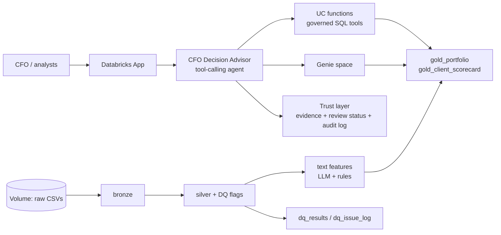

# CFO Portfolio Advisor: IFC CFO Office (team `ifc-cfo-copilot`)

**What it does.** Turns IFC's two separately-held portfolio records into one governed, validated data foundation on Databricks. On top of it sit two agents:
- **Genie**, the portfolio analyst ("what happened?").
- **CFO Decision Advisor**, a team-built tool-calling agent ("so what should we do?").

A Board question that took ~3 weeks to answer, sometimes with conflicting figures, now takes minutes. Every answer:
- uses the same governed definitions,
- shows the exact SQL behind each figure, and
- is labelled `VALIDATED`, `REVIEW_RECOMMENDED` or `HUMAN_REVIEW_REQUIRED`.

This README is the handover document. It explains where everything is, how to run it, how it works, and how to operate and extend it.

---

## 1. Where to find each deliverable

| Brief item | Location |
|---|---|
| Configuration (one place for every name) | `00_setup/00_config` |
| Data pipeline: load, validate, combine | `01_data/01_load_and_prepare` |
| Agent tools, Genie set-up, benchmark set | `02_agent/02_agent_capabilities` |
| Agent build, test, evaluation, MLflow, deployment | `02_agent/03_build_agent` (agent code: `02_agent/cfo_agent.py`) |
| Demo / interface (Databricks App) | `03_demo/04_app.py` (+ `app.yaml`, `requirements.txt` in this folder) |
| WS1: answers to the 30 questions + SQL | `04_answers/ws1/ws1_answers`, table `answers_register` (workstream `WS1`) |
| WS2: two Board questions + SQL | `04_answers/ws2/ws2_board_questions`, table `answers_register` (`WS2`) |
| WS3: four-client recommendation | `04_answers/ws3/ws3_client_recommendations`, table `ws3_recommendations` |
| Architecture diagram | `assets/architecture_diagram_agentic_solution.mmd` (PNG export: `assets/architecture_diagram_agentic_solution.png`) |

## 2. Architecture

| Component | Databricks service | Responsibility | Why this choice |
|---|---|---|---|
| Raw landing | UC **Volume** | Keep files exactly as delivered | Reproducible re-loads; lineage starts at the file |
| Bronze | Delta tables | Lossless load, all strings, source file and load time | Separates "did we load it?" from "is it right?" |
| Silver | Delta tables | Types, trimming, region standardisation, row-level DQ flags | Fixes are explicit and reversible |
| Text features | `ai_query` + SQL rules | Renewable generation, MW, MSME focus, described product | Extracted once in the pipeline, so every user gets the same answer |
| Gold | Delta tables with column comments | One row per project; one row per client | Small, documented surface for Genie and the agent |
| Reference | Delta tables | Assumptions, mappings, vocabulary, reviewer overrides | Business owners change rules without code; agents quote them |
| Tools | **UC SQL functions** | Typed, reviewed queries behind every decision figure | The LLM never writes decision SQL; grants and lineage apply |
| Analyst agent | **Genie** | Open-ended portfolio analytics | Native NL-to-SQL with benchmarks; its SQL is shown to users |
| Decision agent | **MLflow ResponsesAgent** + Foundation Model API | Plans, calls tools, explains, recommends | Loggable, evaluable, servable; same code in the app |
| Trust layer | Agent code + `agent_audit_log` | Evidence footer, review status, audit row | Meets "traceable" and "flag answers that need review" |
| Interface | **Databricks App** (Streamlit) | Chat, Board view, client decisions, trust tab | Runs inside the workspace under a least-privilege service principal |
| Observability | **MLflow** tracing and evaluation | Every step traced; figure-accuracy evaluation | Measurable quality; regression tests for every change |

**Tracing one request.** "Which clients should the Board worry about?"
1. The app calls the Advisor.
2. The LLM chooses `list_clients('REDUCE_OR_REVIEW', 5)`.
3. That UC function reads `gold_client_scorecard`, which comes from `gold_portfolio`, which joins `silver_projects` and `silver_monitoring` on `project_url`, which come from the files in the volume.
4. The LLM then calls `get_client_projects` for evidence and writes the answer.
5. The trust layer appends the SQL used and marks the answer `HUMAN_REVIEW_REQUIRED`, because it is a recommendation.
6. A row is written to `agent_audit_log`.

## 3. How to deploy (fresh workspace, about 30 minutes)

1. **Import** this folder to `Workspace/Teams/<team-name>/`. Files with a `# Databricks notebook source` header become notebooks; `cfo_agent.py`, `04_app.py`, `app.yaml` and `requirements.txt` stay as files.
2. Open `00_setup/00_config`. Set `CATALOG`, `SCHEMA` and `LLM_ENDPOINT` (any chat model under *Serving*). Run it once to create the schema and volume.
3. **Upload** `synthetic_ifc_projects_5000.csv` and `synthetic_project_monitoring.csv` to the volume `raw_files`.
4. Run, in order:
   1. `01_data/01_load_and_prepare` (it stops if any blocking data-quality check fails)
   2. `04_answers/ws1`
   3. `04_answers/ws2`
   4. `04_answers/ws3`
   5. `02_agent/02_agent_capabilities`
5. Create the **Genie space** as described in `02_agent_capabilities`: gold tables, instructions, example SQL, benchmarks. Put its ID and a **SQL warehouse ID** in `00_config`.
6. Run `02_agent/03_build_agent`. It tests the agent, evaluates it, logs it to MLflow, registers it in Unity Catalog and deploys it where serving is available.
7. **App:** *Compute → Apps → Create*. Set the source path to this folder. Add the resources `sql-warehouse` and `genie-space`. Then apply the grants listed at the end of `02_agent_capabilities`.

## 4. Data findings and how each is handled

| # | Finding | Impact if ignored | Treatment |
|---|---|---|---|
| 1 | 475 descriptions contain line breaks; naive CSV readers split them into several rows | Shifted columns; wrong department, category, amounts | `multiLine` + RFC-4180 read; row counts and **control totals reconciled** against an independent calculation (checks B01–B08) |
| 2 | `Project Number` is not unique (3,559 distinct values across 5,000 projects) | A join on it duplicates and mis-attributes exposure | Join on `Project Url`; uniqueness and 1:0..1 asserted (A01, K01–K04) |
| 3 | Monitoring coverage depends on status | Missing data could be mistaken for errors | Dropped = no record; Pending = record without performance or disbursement, both asserted (S01–S03) |
| 4 | 43 projects use region labels not in the dictionary | The same countries split across two region names | Restated via `ref_region_mapping`; original kept (A06) |
| 5 | 37 projects signed before approval; 16 invested with no signing date | Negative or undefined intervals | Excluded from lifecycle averages; logged (A07) |
| 6 | 146 projects: Board total ≠ sum of product allocations by more than $1M | Product mix vs totals disagree | Reported (Q28), not silently fixed (A08) |
| 7 | 5 different snapshot dates | "Last 5 years" would vary with run date | Reporting date fixed to the latest As of Date (A02, A17) |
| 8 | Key facts exist only in free text, with deliberate traps | Keyword search gives wrong answers to Q13, Q24–Q26 | LLM extraction cross-checked by rules; disagreements go to human review (A12–A14) |
| 9 | 31 projects have an empty description | The LLM returns nothing, so these projects get retried forever | Skipped by extraction, labelled `no_description`, logged (D06) |
| 10 | The first full LLM run labelled 228 projects as MSME financing where the rules did not | Q25 over- or under-counts | Review found the LLM right on "small firms / small companies" phrasings (112) and wrong on farms, factories and corporate-only lending (116). Both lessons are encoded as rule changes and LLM guards (A14) |

Text traps include: transmission lines connecting *other sponsors'* wind farms, rooftop solar for own use, battery storage in MWh, GW vs MW, *"rather than SMEs"*, *"Unlike the bank's SME programs"*, "Micronesia", and household microloans.

All checks are stored per run in `dq_results`; row-level issues are in `dq_issue_log`.

## 5. Business definitions

All seventeen are stored in `ref_assumptions` and quoted by Genie and the Advisor. The main ones:
- **Reporting date:** 2026-06-30.
- **Committed:** signed and not Dropped.
- **Current exposure:** disbursed amount on Active projects.
- **Undisbursed commitment:** approved minus disbursed (Active), or the full approved amount (Pending and signed).
- **Expected credit loss:** 60% of disbursed on Past Due projects.
- **Status filters:** applied only when a question states them.

## 6. Client recommendation method (WS3)

`gold_client_scorecard` gives each client:
- exposure: current disbursed, undisbursed and pipeline;
- an exposure-weighted risk rating;
- counts of Past Due, Watchlist and Exited-at-a-loss projects;
- distress share and closed-loss rate;
- a 0–100 health score (40% credit quality, 40% current performance, 20% track record);
- a **rule-based band** (A15).

Within each band, clients are ranked by materiality. A sensitivity check re-ranks them three ways, and picks must be robust. The team records any judgment override with its reason. Every recommendation is stored with its exposure affected (disbursed + undisbursed), project-level evidence, a suggested action, and `requires_human_review = true`.

## 7. Operating the solution

| Task | How |
|---|---|
| New monthly files | Upload to the volume, then re-run `01_data`. Only new or changed descriptions go to the LLM (cached by hash). |
| Review flagged text attributes | Query `gold_project_text_features WHERE needs_review`. Insert decisions into `ref_text_feature_overrides`, then re-run the gold step. |
| Change a policy threshold | Edit the band rule in `01_data` §5 and its text in `ref_assumptions` (A15), then re-run. |
| Check agent quality | `03_build_agent` evaluation. Metrics and traces are in the MLflow experiment `cfo_decision_advisor`. |
| Audit an answer | `agent_audit_log` (question, answer, tools, SQL, review status, user, latency). |
| Access control | Unity Catalog grants. The app's service principal reads only gold and ref tables and executes the functions. |

## 8. Limitations and the path from pilot to scale

- **Prototype:** synthetic data and batch refresh. Exposure is in reported USD (no FX). ECL is the brief's simplified 60% model.
- **Pilot (CFO Office, 1 quarter):**
  - Convert `01_data` to a **Lakeflow Declarative Pipeline**, with the DQ checks as expectations, scheduled as a Job.
  - Connect to source systems instead of files.
  - Collect user feedback through the **Agent Review App**.
  - Expand the Genie benchmark from real analyst questions.
- **Scale:**
  - Add IFRS 9 PD/LGD models in place of the flat 60%.
  - Add market and external research via Vector Search over industry reports.
  - Use row-level security by department, and serve the agent on a Model Serving endpoint with AI Gateway guardrails, rate limits and usage tracking.
  - Track adoption, answer latency and review-override rates as KPIs.
